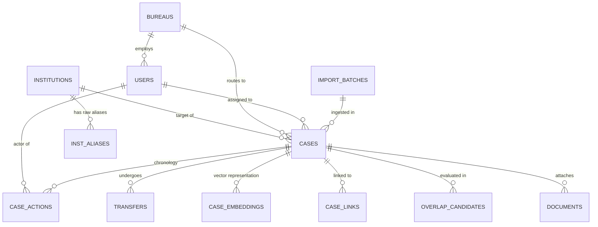

# AICTE Integrated Institution Complaint Monitoring and Status Dashboard
## Database Schema & Data Modeling Specification

> **Database Engine:** MongoDB (v7.0+) with Mongoose ODM (v8.9+)  
> **Status:** Implemented in `backend/src/models/` (phase 2) &bull; see §4 for deviations from this proposal  
> **Source Datasets:** Grounded directly on fixtures in `data/processed/extracted/csv/`  

---

## 1. Entity-Relationship Overview



---

## 2. Detailed Collection Schemas

### 2.1 Collection: `institutions` [PROPOSED]
*Represents the master directory of AICTE-approved educational institutions.*

```javascript
const InstitutionSchema = new mongoose.Schema({
  institution_id: { type: String, required: true, unique: true, index: true }, // e.g. "SYN-INST-0001"
  aicte_permanent_id: { type: String, required: true, unique: true, index: true }, // e.g. "SYN-1-100037"
  name: { type: String, required: true, index: true }, // e.g. "ABC Engineering College"
  stream: { 
    type: String, 
    required: true, 
    enum: ['Engineering', 'Diploma', 'Management', 'Architecture', 'Pharmacy'],
    index: true 
  },
  state: { type: String, required: true, index: true }, // e.g. "Maharashtra"
  district: { type: String, required: true, index: true }, // e.g. "Pune"
  region: { 
    type: String, 
    required: true, 
    enum: ['West', 'South-West', 'South', 'South-Central', 'Northern', 'North-West', 'Eastern', 'Central', 'North-East'],
    index: true 
  },
  ownership: { 
    type: String, 
    enum: ['Private-Self Financing', 'Government Aided', 'Government'],
    required: true 
  },
  established: { type: Number, required: true }, // e.g. 1999
  provenance: { type: String, default: 'SYNTHETIC', enum: ['VERIFIED', 'SYNTHETIC', 'IMPORTED_UNVERIFIED'] }
}, { timestamps: true });

// Compound text index for fuzzy identity lookup
InstitutionSchema.index({ name: 'text', district: 'text', state: 'text' });
```

---

### 2.2 Collection: `inst_aliases` [PROPOSED]
*Test benchmarks and historical raw institution names for Engine D1.*

```javascript
const InstAliasSchema = new mongoose.Schema({
  alias_test_id: { type: String, required: true, unique: true }, // e.g. "SYN-ALIAS-001"
  raw_name: { type: String, required: true, index: true }, // e.g. "abc engg coll"
  raw_location: { type: String, default: null }, // e.g. "Pune"
  expected_institution_id: { type: String, default: null, ref: 'Institution' },
  expected_decision: { 
    type: String, 
    required: true, 
    enum: ['VERIFIED', 'VERIFICATION_QUEUE', 'UNRESOLVED'] 
  },
  case_note: { type: String },
  provenance: { type: String, default: 'SYNTHETIC' }
}, { timestamps: true });
```

---

### 2.3 Collection: `bureaus` [PROPOSED]
*Administrative Bureau master defining standard SLA turnaround times.*

```javascript
const BureauSchema = new mongoose.Schema({
  code: { type: String, required: true, unique: true, enum: ['PGRC', 'RB', 'AB'] },
  name: { type: String, required: true },
  sla_days_default: { type: Number, required: true }, // PGRC: 30, RB: 60, AB: 45
  note: { type: String },
  provenance: { type: String, default: 'SYNTHETIC' }
}, { timestamps: true });
```

---

### 2.4 Collection: `users` [PROPOSED]
*User accounts and RBAC access definitions.*

```javascript
const UserSchema = new mongoose.Schema({
  user_id: { type: String, required: true, unique: true, index: true }, // e.g. "SYN-USR-PGRC-01"
  display_name: { type: String, required: true },
  role: { 
    type: String, 
    required: true, 
    enum: ['bureau_head', 'bureau_officer', 'regional_official', 'senior_management', 'admin'],
    index: true 
  },
  bureau: { type: String, enum: ['PGRC', 'RB', 'AB', null], default: null, index: true },
  region: { type: String, default: null, index: true },
  email: { type: String, required: true, unique: true, lowercase: true },
  password_hash: { type: String, default: 'demo_scram_sha256_mock' },
  is_active: { type: Boolean, default: true },
  provenance: { type: String, default: 'SYNTHETIC' }
}, { timestamps: true });

// Note on users.csv import:
// Row 17 (Regional Official - North-East) must be patched from "SYN-USR-REG-NORTHE" to "SYN-USR-REG-NE"
// and email to "reg-ne@demo.invalid" to resolve the uniqueness collision with row 19 (Northern).
```

---

### 2.5 Collection: `cases` [PROPOSED]
*The core institutional complaint and regulatory case master.*

```javascript
const CaseSchema = new mongoose.Schema({
  case_id: { type: String, required: true, unique: true, index: true }, // e.g. "SYN-PGRC-2026-0001"
  institution_id: { type: String, default: null, ref: 'Institution', index: true },
  identity_status: { 
    type: String, 
    required: true, 
    enum: ['VERIFIED', 'VERIFICATION_QUEUE', 'UNRESOLVED'],
    default: 'VERIFIED',
    index: true 
  },
  raw_institution_name: { type: String, default: null }, // Recorded if unverified
  receipt_date: { type: Date, required: true, index: true },
  category: { type: String, required: true, index: true }, // 15 categories from synthetic matrix
  bureau: { type: String, required: true, enum: ['PGRC', 'RB', 'AB'], index: true },
  assigned_officer: { type: String, default: '', ref: 'User', index: true },
  status: { 
    type: String, 
    required: true, 
    enum: ['Received', 'Assigned', 'Under Process', 'Action Initiated', 'Disposed'],
    default: 'Received',
    index: true 
  },
  last_action: { type: String, default: 'Case registered' },
  last_action_at: { type: Date, default: Date.now },
  next_action: { type: String, default: null },
  expected_disposal_date: { type: Date, required: true, index: true },
  is_overdue: { type: Boolean, default: false, index: true },
  was_transferred: { type: Boolean, default: false },
  region: { type: String, default: null, index: true },
  subject: { type: String, required: true },
  description: { type: String, required: true },
  refs: { type: String, default: null }, // e.g. "SYN/LTR/2026/168"
  complainant_ref: { type: String, select: false }, // Internal synthetic key (hidden from public queries)
  complainant_hash: { type: String, required: true, index: true }, // Salted SHA-256
  matter_id: { type: String, select: false }, // Ground truth marker (hidden from engine)
  design_note: { type: String, default: null },
  provenance: { type: String, default: 'SYNTHETIC', enum: ['SYNTHETIC', 'IMPORTED_UNVERIFIED'] }
}, { timestamps: true });

// Compound indexes for high-throughput dashboard queries
CaseSchema.index({ bureau: 1, status: 1, is_overdue: 1 });
CaseSchema.index({ institution_id: 1, receipt_date: -1 });
CaseSchema.index({ expected_disposal_date: 1, status: 1 });
```

---

### 2.6 Collection: `case_actions` [PROPOSED]
*Immutable, append-only chronological history for full statutory audit trails.*

```javascript
const CaseActionSchema = new mongoose.Schema({
  case_id: { type: String, required: true, ref: 'Case', index: true },
  ts: { type: Date, required: true, index: true },
  actor: { type: String, required: true }, // e.g. "SYN-USR-PGRC-01" or "system"
  action_type: { 
    type: String, 
    required: true, 
    enum: ['created', 'assigned', 'status_change', 'document', 'transfer', 'escalation'],
    index: true 
  },
  remarks: { type: String, required: true },
  from_status: { type: String, default: null },
  to_status: { type: String, default: null },
  provenance: { type: String, default: 'SYNTHETIC' }
}, { timestamps: true });

CaseActionSchema.index({ case_id: 1, ts: 1 });
```

---

### 2.7 Collection: `transfers` [PROPOSED]
*Formal inter-Bureau case handoff records.*

```javascript
const TransferSchema = new mongoose.Schema({
  case_id: { type: String, required: true, ref: 'Case', index: true },
  from_bureau: { type: String, required: true, enum: ['PGRC', 'RB', 'AB'] },
  to_bureau: { type: String, required: true, enum: ['PGRC', 'RB', 'AB'] },
  reason: { type: String, required: true },
  requested_by: { type: String, required: true },
  requested_at: { type: Date, required: true },
  accepted_by: { type: String, required: true },
  accepted_at: { type: Date, required: true },
  state: { type: String, default: 'accepted', enum: ['pending', 'accepted', 'rejected'] },
  provenance: { type: String, default: 'SYNTHETIC' }
}, { timestamps: true });
```

---

### 2.8 Collection: `category_matrix` [PROPOSED]
*Cross-Bureau category relatedness rules.*

```javascript
const CategoryMatrixSchema = new mongoose.Schema({
  category_a: { type: String, required: true },
  bureau_a: { type: String, required: true },
  category_b: { type: String, required: true },
  bureau_b: { type: String, required: true },
  rule_points: { type: Number, default: 0.25 },
  provenance: { type: String, default: 'SYNTHETIC' }
});

CategoryMatrixSchema.index({ category_a: 1, category_b: 1 }, { unique: true });
```

---

### 2.9 Collection: `overlap_candidates` [PROPOSED]
*Scored candidate pairs for Engine D2 and Coordination Centre alerts.*

```javascript
const OverlapCandidateSchema = new mongoose.Schema({
  pair_key: { type: String, required: true, unique: true, index: true }, // e.g. "SYN-PGRC-2026-0001:SYN-RB-2026-0002"
  case_a: { type: String, required: true, ref: 'Case', index: true },
  case_b: { type: String, required: true, ref: 'Case', index: true },
  institution_id: { type: String, required: true, ref: 'Institution', index: true },
  score: { type: Number, required: true }, // e.g. 0.82
  band: { type: String, required: true, enum: ['HIGH', 'MEDIUM', 'NONE'] },
  reasons: [{ type: String }], // Explainability tokens
  alert_active: { type: Boolean, default: true, index: true },
  official_decision: { 
    type: String, 
    enum: ['pending', 'confirmed_linked', 'dismissed_unrelated'], 
    default: 'pending' 
  },
  decided_by: { type: String, default: null },
  decided_at: { type: Date, default: null },
  decision_note: { type: String, default: null },
  provenance: { type: String, default: 'DERIVED' }
}, { timestamps: true });
```

---

### 2.10 Collection: `case_embeddings` [PROPOSED]
*Dense semantic vectors for similarity comparison.*

```javascript
const CaseEmbeddingSchema = new mongoose.Schema({
  case_id: { type: String, required: true, unique: true, index: true },
  model: { type: String, default: 'all-MiniLM-L6-v2' },
  vector: { type: [Number], required: true }, // 384-dimensional float array
  text_hash: { type: String, required: true }, // SHA-256 of embedded text
  provenance: { type: String, default: 'DERIVED' }
}, { timestamps: true });
```

---

### 2.11 Collection: `notifications` & `audit_logs` [PROPOSED]
*Real-time alerts and security audit tracking.*

```javascript
const NotificationSchema = new mongoose.Schema({
  user_id: { type: String, required: true, index: true },
  type: { type: String, required: true, enum: ['SLA_OVERDUE', 'OVERLAP_ALERT', 'CASE_ASSIGNED', 'TRANSFER_REQUEST'] },
  title: { type: String, required: true },
  message: { type: String, required: true },
  case_id: { type: String, default: null },
  is_read: { type: Boolean, default: false, index: true },
  created_at: { type: Date, default: Date.now, expires: '60d' } // Auto TTL 60 days
});

const AuditLogSchema = new mongoose.Schema({
  actor: { type: String, required: true, index: true },
  action: { type: String, required: true },
  entity_type: { type: String, required: true }, // "case", "user", "coordination"
  entity_id: { type: String, required: true },
  before_state: { type: mongoose.Schema.Types.Mixed, default: null },
  after_state: { type: mongoose.Schema.Types.Mixed, default: null },
  ip: { type: String, default: null },
  timestamp: { type: Date, default: Date.now, immutable: true }
});
```

---

## 3. Schema Implementation Plan for Claude Pro

1. **Step 1:** Create Mongoose models in `backend/src/models/` mirroring the definitions above.
2. **Step 2:** Write a seed script `backend/scripts/seed_database.js` that:
   - Reads `data/processed/extracted/csv/`.
   - Patches the `users.csv` duplicate key (`SYN-USR-REG-NORTHE` for North-East &rarr; `SYN-USR-REG-NE`).
   - Upserts institutions, bureaus, users, category matrix, cases, case actions, transfers, and ground truth pairs.
3. **Step 3:** Add MongoDB compound indexes and verify with `db.collection.getIndexes()`.


---

## 4. Implementation Notes and Deviations (phase 2)

The models in `backend/src/models/` follow this specification with these deliberate changes:

| Area | Change | Reason |
|---|---|---|
| `cases.refs` | Stored as an **array** of strings (CSV value split on `;`), indexed | The shared-reference rule in Engine D2 needs to match individual references |
| `cases.institution_id` | Required when `identity_status = VERIFIED`; must be empty otherwise | Uncertain identities are never linked to an institution |
| `cases.assigned_officer` | `null` (not `''`) when unassigned; required once status is past `Received` | Matches the data; enforces the workflow |
| `cases.design_note`, `cases.complainant_hash` | `design_note` is `select: false`; `complainant_hash` is excluded from API responses | `design_note` reveals generator ground truth; the hash is only for the engine |
| `cases` text index | `subject` + `description` text index added | Reserved for future search; the API currently uses escaped regex search |
| `users.password_hash` | Default `null`, `select: false` (no placeholder hash) | Auth is not implemented; no fake credentials are stored |
| `users.source_user_id` | New field | Records the original ID when transformation T1 renamed a user |
| `case_actions.action_key` | New unique field = SHA-256 of the row | The CSV has no action ID; makes re-import idempotent and collapses exact duplicates |
| `transfers.transfer_key` | New unique field = `case_id@requested_at` | The CSV has no transfer ID |
| `overlap_ground_truth` | New model (`OverlapGroundTruth`) with unique `pair_id` and unique (`case_a`, `case_b`) | Evaluation labels for Engine D2; the engine must not read it |
| `import_meta` | Hidden sub-document on every imported record (source file/row/hash, batches, transformations) | Provenance and idempotent re-import |
| `import_batches` | New collection, one document per import run | Audit of every import (file hashes, counts, rejections) |
| Indexes | Created with `createIndexes()` by the seed script; server start-up uses Mongoose `autoIndex` | Never drops existing indexes |

`overlap_candidates`, `case_embeddings`, `notifications` and `audit_logs` exist with their indexes but are empty until later phases. `case_links` (shown in the ER diagram) is not implemented yet (phase 5).
