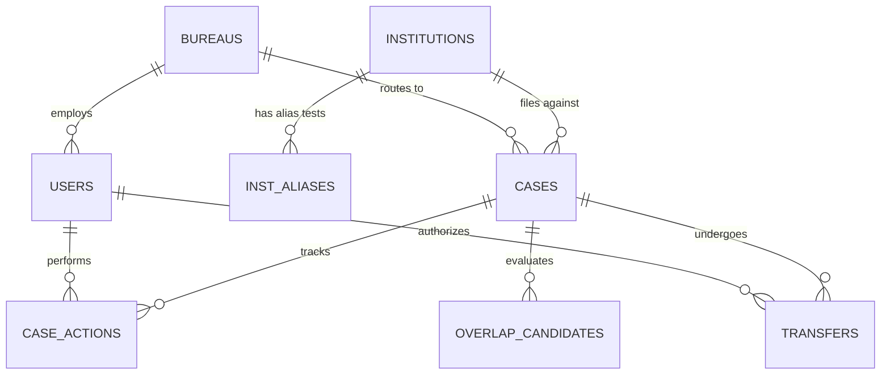

# AICTE Integrated Institution Complaint Monitoring and Status Dashboard
## Dataset Assessment and Technical Feasibility Report

> **Project Name:** AICTE Integrated Institution Complaint Monitoring and Status Dashboard  
> **Initiative:** Smart India Hackathon (SIH) 2026  
> **Document Purpose:** Comprehensive data assessment, schema inspection, data-quality audit, provenance verification, and ingestion architecture prior to application initialization.  
> **Date of Assessment:** October 2026  
> **Target Framework:** React SPA · Node.js / Express Modular Monolith · MongoDB Replica Set · Transformers.js (`all-MiniLM-L6-v2`) · Agenda.js Scheduling  

---

## 1. Executive Summary

This assessment document inspects and analyzes the data files provided for the **AICTE Integrated Institution Complaint Monitoring and Status Dashboard**. The objective of the SIH problem statement is to establish an institutional complaint monitoring ecosystem for AICTE that tracks complaints across their lifecycle, resolves institution identity, detects cross-Bureau duplicate/overlapping matters (e.g. between the Public Grievance Redressal Cell [PGRC], Regulation Bureau [RB], and Approval Bureau [AB]), and enforces SLA-driven accountability.

A thorough inspection of all workspaces and downloaded bundles reveals two distinct data tiers:
1. **Historical Raw/Cleaned Dataset (`ACSS` - AICTE Centralized Support System):** Sourced from the Harvard Dataverse (Jan–Sep 2022). While genuine, **82.3% of this dataset consists of portal IT technical support tickets** (e.g., DSC token errors, login failures, fee transaction drops, application submission glitches) submitted by institutions themselves. Only **28 rows (10 distinct matters, 0.25%)** represent genuine complaints against institutions. The dataset lacks institution IDs, Bureau routing, assigned officers, case lifecycle states, and resolution timestamps.
2. **Synthetic Prototype Dataset:** A mathematically calibrated synthetic monitoring layer specifically built to mirror the AICTE operational architecture. It supplies 61 fictional institutions, 130 identity-resolution test cases, 3 Bureaus, 27 role-numbered officer accounts, 809 cases with realistic lifecycle states, 4,099 chronological action entries, 25 Bureau transfers, and 214 rigorously labelled case pairs for evaluating the cross-Bureau overlap engine.

The data integrity of the synthetic layer was verified through automated assertions (`verify.py`), passing with **zero validation errors**. An important bug was uncovered during our inspection: a string-truncation collision in `users.csv` where both the Northern and North-East regional officials were assigned the duplicate ID `SYN-USR-REG-NORTHE`.

---

## 2. Files Found & Inspection Inventory

All files referenced in the workspace instructions have been located, inspected, and cataloged. The table below lists their paths, sizes, formats, and inspection status:

| File / Directory Path | Size (Bytes) | Format | Classification | Inspection Status |
|---|---|---|---|---|
| `data/raw/dataverse_files.zip` | 2,977,168 | ZIP Archive | Historical Raw Data | Inspected; extracted in `Downloads/raw_data` |
| `Downloads/raw_data/ACSSv1.xlsx` | 2,387,916 | Excel (.xlsx) | Historical Raw Data | Fully inspected (14,272 rows) |
| `Downloads/raw_data/ACSS - Tablesv1.xlsx` | 43,704 | Excel (.xlsx) | Historical Statistical Summaries | Fully inspected (5 statistical sheets) |
| `Downloads/raw_data/ACSS.pkl` | 1,769,450 | Python Pickle | Historical Text & Embeddings | Fully inspected (4,944 rows x 2 cols) |
| `data/processed/SIH2026_dataset_csv_and_scripts.zip` | 2,154,081 | ZIP Archive | Processed CSVs & Code | Inspected; extracted in `data/processed/extracted` |
| `data/processed/SIH2026_AICTE_prototype_dataset.xlsx` | 3,278,082 | Excel (.xlsx) | Multi-sheet Master Workbook | Fully inspected (14 sheets) |
| `docs/architecture.png` | 1,040,360 | PNG Image | System Architecture Blueprint | Visually and structurally analyzed |
| `data/processed/extracted/csv/acss_clean.csv` | 9,415,930 | CSV | Cleaned Historical Data | Fully profiled (11,095 rows, 25 cols) |
| `data/processed/extracted/csv/acss_grievances.csv` | 38,670 | CSV | Cleaned Institutional Grievances | Fully profiled (28 rows, 25 cols) |
| `data/processed/extracted/csv/bureaus.csv` | 355 | CSV | Master Synthetic Configuration | Fully profiled (3 rows, 5 cols) |
| `data/processed/extracted/csv/users.csv` | 2,470 | CSV | Synthetic RBAC Accounts | Fully profiled (27 rows, 7 cols) |
| `data/processed/extracted/csv/institutions.csv` | 7,607 | CSV | Synthetic Institution Master | Fully profiled (61 rows, 10 cols) |
| `data/processed/extracted/csv/institution_alias_tests.csv` | 13,283 | CSV | Test Suite for D1 Identity Engine | Fully profiled (130 rows, 7 cols) |
| `data/processed/extracted/csv/category_matrix.csv` | 915 | CSV | Cross-Bureau Category Rules | Fully profiled (13 rows, 6 cols) |
| `data/processed/extracted/csv/cases.csv` | 394,344 | CSV | Synthetic Case Master | Fully profiled (809 rows, 24 cols) |
| `data/processed/extracted/csv/case_actions.csv` | 503,184 | CSV | Chronological Action Audit Trail | Fully profiled (4,099 rows, 8 cols) |
| `data/processed/extracted/csv/transfers.csv` | 4,038 | CSV | Inter-Bureau Transfer Records | Fully profiled (25 rows, 10 cols) |
| `data/processed/extracted/csv/overlap_ground_truth.csv` | 46,576 | CSV | Overlap Benchmark Ground Truth | Fully profiled (214 rows, 16 cols) |
| `data/processed/extracted/scripts/clean_acss.py` | 19,378 | Python Script | Data Cleaning & PII Redaction | Fully audited |
| `data/processed/extracted/scripts/gen_synthetic.py` | 38,400 | Python Script | Synthetic Data Generator | Fully audited |
| `data/processed/extracted/scripts/package.py` | 18,825 | Python Script | Excel & Zip Packaging Script | Fully audited |
| `data/processed/extracted/scripts/verify.py` | 1,912 | Python Script | Assertion & Baseline Benchmark | Executed & verified |

---

## 3. Dataset Descriptions & Provenance Architecture

### 3.1 Historical Dataset (Harvard Dataverse ACSS)
- **Origin:** *ACSS (AICTE Centralized Support System) Data Set*, published on Harvard Dataverse on 2024-01-05 by Manoj Singh, Subhash Panwar, and Sanju Choudhary (`https://doi.org/10.7910/DVN/EITGBB`).
- **Nature of the Data:** Covers support requests and tickets logged in AICTE's portal between January and September 2022.
- **Original Dimensions:** 14,272 rows and 7 raw columns.
- **Cleaning & Filtering Pipeline:**
  1. Removed **3,174 exact duplicate rows** where module, nature, subject, description, type, and timestamp were identical.
  2. Removed **3 test / junk rows** (descriptions like `"test"`, `"testing"`, or string length < 10 characters).
  3. Cleaned record count: **11,095 rows**.
  4. Redacted Personally Identifiable Information (PII) including personal names, emails, mobile numbers, bank account numbers, IFSC codes, PAN numbers, URLs, and AICTE permanent IDs using regular expressions and spaCy NER.
  5. Parsed dual date formats; flagged 4,524 rows with ambiguous day/month order (`date_confidence = medium`).
  6. Classified each record into 6 operational categories via rule-based keyword matching.

### 3.2 Prototype Synthetic Monitoring Layer
Because the genuine ACSS dataset contains no institutional complaint workflow metadata, a synthetic monitoring dataset was engineered to satisfy the SIH problem statement:
- **Institutions (61 records):** Fictional institution names using letter-triplet prefixes (e.g., *ABC Engineering College*, *BCD Institute of Management*), fictional AICTE IDs (`SYN-1-XXXXXX`), distributed across 9 AICTE administrative regions and 14 states. Contains deliberate edge cases (e.g., two distinct institutions named *PQR Institute of Technology*, one in Pune, Maharashtra and one in Belagavi, Karnataka).
- **Identity Tests (130 records):** Evaluation benchmark for Engine D1 containing raw strings with typos, contractions (*Engg.*, *Coll.*, *Inst.*), dotted acronyms, and missing cities to test fuzzy matching and verification queue routing.
- **Bureaus & Roles (3 Bureaus, 27 Users):** Defines the Public Grievance Redressal Cell (`PGRC`), Regulation Bureau (`RB`), and Approval Bureau (`AB`) with synthetic SLA configurations (30, 60, and 45 days). 27 accounts cover 5 roles (`bureau_head`, `bureau_officer`, `regional_official`, `senior_management`, `admin`).
- **Cases (809 records):** Covers realistic case distribution:
  - 465 Disposed (57.5%)
  - 132 Under Process (16.3%)
  - 89 Action Initiated (11.0%)
  - 85 Assigned (10.5%)
  - 38 Received (4.7%)
  - 162 cases are overdue (past expected disposal date as of demo "today": 2026-10-31).
  - 4 cases have unverified institution identities (`VERIFICATION_QUEUE` or `UNRESOLVED`).
- **Case Actions (4,099 records):** Append-only audit trail logging status transitions, officer assignments, document uploads (`institute_reply.pdf`), inter-Bureau transfers, and two-stage automated SLA escalations.
- **Transfers (25 records):** Inter-Bureau case handoffs with initiating Bureau, receiving Bureau, justification, and request/acceptance timestamps.
- **Overlap Ground Truth (214 labelled pairs):** Benchmark for Engine D2 containing 101 `same_matter` pairs (40 sharing a formal reference number), 98 `different_matter` pairs (30 hard negatives with overlapping categories but different academic years or departments), and 15 intra-Bureau duplicate submissions. 87 pairs are designated to trigger cross-Bureau coordination alerts.

---

## 4. Comprehensive Data Dictionaries & Column Profiles

### 4.1 `acss_clean.csv` (Cleaned Historical Dataset)
- **Record Count:** 11,095 rows | **Column Count:** 25 | **Size:** 9,415,930 bytes | **Provenance:** `IMPORTED_UNVERIFIED`

| Column Name | Data Type | Null Count | Null % | Unique | Description & Allowed Values |
|---|---|---|---|---|---|
| `acss_id` | `object` | 0 | 0.0% | 11,095 | Unique stable primary identifier (e.g. `ACSS-00005`). |
| `source_row` | `int64` | 0 | 0.0% | 11,095 | Original Excel row index in raw `ACSSv1.xlsx` (for traceability). |
| `created_on` | `object` | 0 | 0.0% | 11,053 | Submission timestamp (e.g. `2022-04-11 16:30:13`). |
| `date_confidence` | `object` | 0 | 0.0% | 2 | `high` (unambiguous day > 12) or `medium` (day <= 12). |
| `type` | `object` | 0 | 0.0% | 7 | Original ticket type: `Enquiry`, `Grievance`, `Required Support`, etc. |
| `module` | `object` | 0 | 0.0% | 10 | AICTE portal module: `Payment`, `Faculty`, `DSC Utility`, `Course`, etc. |
| `nature` | `object` | 0 | 0.0% | 41 | Specific issue nature (e.g. `Payment Updation Issue`, `Deficiency related Query`). |
| `subject` | `object` | 0 | 0.0% | 9,753 | Cleaned ticket subject with PII replaced. |
| `description` | `object` | 0 | 0.0% | 10,481 | Cleaned ticket text body with PII tokens. |
| `desc_len` | `int64` | 0 | 0.0% | 974 | Character length of the description string. |
| `embed_eligible` | `bool` | 0 | 0.0% | 2 | `True` if `desc_len` >= 40 chars (eligible for semantic embedding); `False` otherwise. |
| `record_class` | `object` | 0 | 0.0% | 6 | Re-classification: `portal_technical_support`, `policy_or_approval_enquiry`, `faculty_record_dispute`, `grievance_against_institution`, `feedback_appreciation_suggestion`, `other_unclear`. |
| `class_method` | `object` | 0 | 0.0% | 1 | Method used for classification (`keyword_rules_v1 (unreviewed)`). |
| `review_status` | `object` | 0 | 0.0% | 2 | `rules_only` (11,059 rows) or `reviewed_by_assistant_needs_team_confirmation` (36 rows). |
| `suggested_demo_use` | `object` | 0 | 0.0% | 6 | Recommendation on how the record can be utilized in the demo. |
| `complaint_group` | `object` | 0 | 0.0% | 10,172 | Hash identifier grouping near-duplicate complaints resubmitted across days. |
| `is_resubmission` | `bool` | 0 | 0.0% | 2 | `True` for 2nd+ submissions of the same complaint; `False` for first instance. |
| `redactions` | `object` | 5,838 | 52.6% | 132 | Comma-separated list of redacted PII categories: `PERSON`, `INSTITUTION`, `PHONE`, etc. |
| `had_aicte_id` | `bool` | 0 | 0.0% | 2 | `True` if description cited an AICTE permanent ID. |
| `dup_group` | `int64` | 0 | 0.0% | 377 | Grouping index for exact-text repeated submissions (-1 if unique). |
| `is_repeat_submission` | `bool` | 0 | 0.0% | 2 | `True` if identical subject+description text was previously seen. |
| `row_hash` | `object` | 0 | 0.0% | 10,555 | SHA-256 fingerprint for deduplication on ingestion. |
| `provenance` | `object` | 0 | 0.0% | 1 | Data provenance watermark (`IMPORTED_UNVERIFIED`). |
| `source_dataset` | `object` | 0 | 0.0% | 1 | Citation string (`ACSS Data Set, Harvard Dataverse`). |
| `source_doi` | `object` | 0 | 0.0% | 1 | DOI citation (`https://doi.org/10.7910/DVN/EITGBB`). |

---

### 4.2 `acss_grievances.csv` (Verified Institutional Grievance Subset)
- **Record Count:** 28 rows | **Column Count:** 25 | **Size:** 38,670 bytes | **Provenance:** `IMPORTED_UNVERIFIED`
- Contains identical columns to `acss_clean.csv`. Represents the filtered and human-reviewed subset of 28 rows (10 distinct complaint matters) that represent authentic grievances against institutions (fee refund refusals, withheld service gratuity, non-payment of faculty salary, and misuse of faculty profiles).

---

### 4.3 `institutions.csv` (Synthetic Institution Master)
- **Record Count:** 61 rows | **Column Count:** 10 | **Size:** 7,607 bytes | **Provenance:** `SYNTHETIC`

| Column Name | Data Type | Null Count | Null % | Unique | Description & Allowed Values |
|---|---|---|---|---|---|
| `institution_id` | `object` | 0 | 0.0% | 61 | Fictional primary key: `SYN-INST-0001` through `SYN-INST-0061`. |
| `aicte_permanent_id`| `object` | 0 | 0.0% | 61 | Fictional AICTE registration ID (e.g. `SYN-1-100037`). |
| `name` | `object` | 0 | 0.0% | 60 | Fictional name with 3-letter prefix (60 unique; 1 deliberate duplicate name). |
| `stream` | `object` | 0 | 0.0% | 5 | Disciplines: `Engineering` (30), `Diploma` (12), `Management` (8), `Architecture` (8), `Pharmacy` (3). |
| `state` | `object` | 0 | 0.0% | 14 | Real Indian state: `Maharashtra`, `Karnataka`, `Tamil Nadu`, `Rajasthan`, etc. |
| `district` | `object` | 0 | 0.0% | 20 | Real district/city: `Pune`, `Belagavi`, `Coimbatore`, `Jaipur`, `Ludhiana`, etc. |
| `region` | `object` | 0 | 0.0% | 9 | AICTE administrative region: `West`, `South-West`, `South`, `South-Central`, `Northern`, `North-West`, `Eastern`, `Central`, `North-East`. |
| `ownership` | `object` | 0 | 0.0% | 3 | Type: `Private-Self Financing` (26), `Government Aided` (19), `Government` (16). |
| `established` | `int64` | 0 | 0.0% | 28 | Year of establishment (ranging from 1985 to 2018). |
| `provenance` | `object` | 0 | 0.0% | 1 | Stamped as `SYNTHETIC`. |

---

### 4.4 `institution_alias_tests.csv` (Identity Resolution Test Suite)
- **Record Count:** 130 rows | **Column Count:** 7 | **Size:** 13,283 bytes | **Provenance:** `SYNTHETIC`

| Column Name | Data Type | Null Count | Null % | Unique | Description & Allowed Values |
|---|---|---|---|---|---|
| `alias_test_id` | `object` | 0 | 0.0% | 130 | Identifier: `SYN-ALIAS-001` to `SYN-ALIAS-130`. |
| `raw_name` | `object` | 0 | 0.0% | 130 | Raw un-normalized institution string (abbreviations, typos, lowercase, dotted initials). |
| `raw_location` | `object` | 42 | 32.3% | 20 | Accompanying location string if available (or null). |
| `expected_institution_id` | `object` | 4 | 3.1% | 61 | Expected resolved `institution_id` (empty if unresolved). |
| `expected_decision` | `object` | 0 | 0.0% | 3 | Expected Engine D1 output: `VERIFIED` (126), `VERIFICATION_QUEUE` (2), `UNRESOLVED` (2). |
| `case_note` | `object` | 0 | 0.0% | 10 | Diagnostic note explaining the test condition (e.g. `location disambiguates`, `typo + abbreviation`). |
| `provenance` | `object` | 0 | 0.0% | 1 | Stamped as `SYNTHETIC`. |

---

### 4.5 `bureaus.csv` (Bureau Configuration Master)
- **Record Count:** 3 rows | **Column Count:** 5 | **Size:** 355 bytes | **Provenance:** `SYNTHETIC`

| Column Name | Data Type | Null Count | Null % | Unique | Description & Allowed Values |
|---|---|---|---|---|---|
| `code` | `object` | 0 | 0.0% | 3 | Bureau short code: `PGRC`, `RB`, `AB`. |
| `name` | `object` | 0 | 0.0% | 3 | Bureau title: `Public Grievance Redressal Cell`, `Regulation Bureau`, `Approval Bureau`. |
| `sla_days_default` | `int64` | 0 | 0.0% | 3 | Standard turnaround SLA (days): PGRC (30), RB (60), AB (45). |
| `provenance` | `object` | 0 | 0.0% | 1 | Stamped as `SYNTHETIC`. |
| `note` | `object` | 0 | 0.0% | 3 | Clarifying notes regarding synthetic configuration. |

---

### 4.6 `users.csv` (System Users & Role-Based Access)
- **Record Count:** 27 rows | **Column Count:** 7 | **Size:** 2,470 bytes | **Provenance:** `SYNTHETIC`

| Column Name | Data Type | Null Count | Null % | Unique | Description & Allowed Values |
|---|---|---|---|---|---|
| `user_id` | `object` | 0 | 0.0% | 26 | Account ID (e.g. `SYN-USR-PGRC-H`, `SYN-USR-PGRC-01`). *Note: 1 duplicate found.* |
| `display_name` | `object` | 0 | 0.0% | 27 | Sanitized role title (e.g. `PGRC Bureau Head`, `Regional Official (West)`). |
| `role` | `object` | 0 | 0.0% | 5 | RBAC role: `bureau_head` (3), `bureau_officer` (12), `regional_official` (9), `senior_management` (2), `admin` (1). |
| `bureau` | `object` | 12 | 44.4% | 3 | Associated Bureau code (`PGRC`, `RB`, `AB`) or null for regional/admin users. |
| `region` | `object` | 18 | 66.7% | 9 | Geographic scope for regional officials (e.g. `West`, `South-West`) or null. |
| `email` | `object` | 0 | 0.0% | 26 | Safe email on reserved RFC 2606 domain (e.g. `pgrc-h@demo.invalid`). |
| `provenance` | `object` | 0 | 0.0% | 1 | Stamped as `SYNTHETIC`. |

---

### 4.7 `category_matrix.csv` (Cross-Bureau Related Category Rules)
- **Record Count:** 13 rows | **Column Count:** 6 | **Size:** 915 bytes | **Provenance:** `SYNTHETIC`

| Column Name | Data Type | Null Count | Null % | Unique | Description & Allowed Values |
|---|---|---|---|---|---|
| `category_a` | `object` | 0 | 0.0% | 10 | Primary category (e.g. `fee_refund`, `salary_non_payment`, `admission_irregularity`). |
| `bureau_a` | `object` | 0 | 0.0% | 2 | Bureau managing category A (`PGRC` or `RB`). |
| `category_b` | `object` | 0 | 0.0% | 8 | Cross-Bureau related category (e.g. `fee_regulation_compliance`, `faculty_norms_compliance`). |
| `bureau_b` | `object` | 0 | 0.0% | 2 | Bureau managing category B (`RB` or `AB`). |
| `rule_points` | `float64` | 0 | 0.0% | 1 | Fixed rule bonus weight added to relationship score: `0.25`. |
| `provenance` | `object` | 0 | 0.0% | 1 | Stamped as `SYNTHETIC`. |

---

### 4.8 `cases.csv` (Core Case Master)
- **Record Count:** 809 rows | **Column Count:** 24 | **Size:** 394,344 bytes | **Provenance:** `SYNTHETIC`

| Column Name | Data Type | Null Count | Null % | Unique | Description & Allowed Values |
|---|---|---|---|---|---|
| `case_id` | `object` | 0 | 0.0% | 809 | Primary key: `SYN-{BUREAU}-{YYYY}-{SEQ}` (e.g. `SYN-PGRC-2026-0001`). |
| `institution_id` | `object` | 4 | 0.5% | 61 | Foreign key to `institutions.csv`. Empty for unverified identity cases. |
| `identity_status` | `object` | 0 | 0.0% | 3 | Gating state: `VERIFIED` (805), `VERIFICATION_QUEUE` (2), `UNRESOLVED` (2). |
| `raw_institution_name` | `object` | 805 | 99.5% | 4 | Populated only when identity is unverified or under review. |
| `receipt_date` | `object` | 0 | 0.0% | 277 | Registration date (from 2025-11-01 to 2026-10-31). |
| `category` | `object` | 0 | 0.0% | 15 | Case category (15 distinct types across PGRC, RB, AB). |
| `bureau` | `object` | 0 | 0.0% | 3 | Assigned Bureau: `PGRC` (394), `RB` (285), `AB` (130). |
| `assigned_officer` | `object` | 38 | 4.7% | 12 | Foreign key to `users.csv`. Empty if status is `Received`. |
| `status` | `object` | 0 | 0.0% | 5 | Lifecycle: `Disposed` (465), `Under Process` (132), `Action Initiated` (89), `Assigned` (85), `Received` (38). |
| `last_action` | `object` | 0 | 0.0% | 108 | Text summary of most recent action on the case. |
| `last_action_at` | `object` | 0 | 0.0% | 598 | Timestamp of the most recent action. |
| `next_action` | `object` | 465 | 57.5% | 4 | Required next operational task (null for Disposed cases). |
| `expected_disposal_date` | `object` | 0 | 0.0% | 287 | SLA deadline date based on bureau and category rules. |
| `is_overdue` | `bool` | 0 | 0.0% | 2 | Computed flag: `True` if active and past expected disposal date (162 cases). |
| `was_transferred` | `bool` | 0 | 0.0% | 2 | `True` if case underwent an inter-Bureau transfer (25 cases). |
| `region` | `object` | 4 | 0.5% | 9 | Institution region (null for unresolved institution cases). |
| `subject` | `object` | 0 | 0.0% | 18 | Case title / subject summary. |
| `description` | `object` | 0 | 0.0% | 789 | Detailed complaint narrative or regulatory notice text. |
| `refs` | `object` | 729 | 90.1% | 60 | Cited reference letters or prior case IDs (used by rule engine). |
| `complainant_ref` | `object` | 0 | 0.0% | 771 | Internal synthetic complainant key (e.g. `SYN-CMP-00101`). |
| `complainant_hash` | `object` | 0 | 0.0% | 771 | Salted SHA-256 hash of complainant ID (privacy-compliant store). |
| `matter_id` | `object` | 4 | 0.5% | 689 | Generator ground truth tracking ID (hidden from runtime app). |
| `design_note` | `object` | 802 | 99.1% | 5 | Synthetic test scenario annotations (e.g. scripted demo pairs). |
| `provenance` | `object` | 0 | 0.0% | 1 | Stamped as `SYNTHETIC`. |

---

### 4.9 `case_actions.csv` (Case Lifecycle Action History)
- **Record Count:** 4,099 rows | **Column Count:** 8 | **Size:** 503,184 bytes | **Provenance:** `SYNTHETIC`

| Column Name | Data Type | Null Count | Null % | Unique | Description & Allowed Values |
|---|---|---|---|---|---|
| `case_id` | `object` | 0 | 0.0% | 809 | Foreign key referencing `cases.case_id`. |
| `ts` | `object` | 0 | 0.0% | 2,699 | Action timestamp. |
| `actor` | `object` | 0 | 0.0% | 17 | User ID or system daemon executing the action (`system` for escalations). |
| `action_type` | `object` | 0 | 0.0% | 6 | Event type: `status_change` (1,705), `created` (809), `assigned` (771), `document` (533), `escalation` (256), `transfer` (25). |
| `remarks` | `object` | 0 | 0.0% | 182 | Action summary (e.g. *Show-cause notice issued*, *Overdue 11 days: escalated to Bureau head*). |
| `from_status` | `object` | 1,598 | 39.0% | 4 | Starting status (null for case creation, document uploads, or escalations). |
| `to_status` | `object` | 789 | 19.2% | 5 | Target status after state transition. |
| `provenance` | `object` | 0 | 0.0% | 1 | Stamped as `SYNTHETIC`. |

---

### 4.10 `transfers.csv` (Inter-Bureau Transfers)
- **Record Count:** 25 rows | **Column Count:** 10 | **Size:** 4,038 bytes | **Provenance:** `SYNTHETIC`

| Column Name | Data Type | Null Count | Null % | Unique | Description & Allowed Values |
|---|---|---|---|---|---|
| `case_id` | `object` | 0 | 0.0% | 25 | Foreign key referencing `cases.case_id`. |
| `from_bureau` | `object` | 0 | 0.0% | 2 | Originating Bureau: `AB` (17) or `PGRC` (8). |
| `to_bureau` | `object` | 0 | 0.0% | 2 | Destination Bureau: `PGRC` (17) or `AB` (8). |
| `reason` | `object` | 0 | 0.0% | 1 | Justification text (`Subject matter falls under receiving Bureau`). |
| `requested_by`| `object` | 0 | 0.0% | 2 | Initiating Bureau head user ID. |
| `requested_at`| `object` | 0 | 0.0% | 25 | Timestamp of transfer request. |
| `accepted_by` | `object` | 0 | 0.0% | 2 | Receiving Bureau head user ID. |
| `accepted_at` | `object` | 0 | 0.0% | 25 | Timestamp of formal acceptance. |
| `state` | `object` | 0 | 0.0% | 1 | State of transfer: `accepted` (all 25). |
| `provenance` | `object` | 0 | 0.0% | 1 | Stamped as `SYNTHETIC`. |

---

### 4.11 `overlap_ground_truth.csv` (Relationship & Overlap Benchmark)
- **Record Count:** 214 rows | **Column Count:** 16 | **Size:** 46,576 bytes | **Provenance:** `SYNTHETIC`

| Column Name | Data Type | Null Count | Null % | Unique | Description & Allowed Values |
|---|---|---|---|---|---|
| `pair_id` | `object` | 0 | 0.0% | 214 | Primary key: `SYN-PAIR-001` to `SYN-PAIR-214`. |
| `case_a` | `object` | 0 | 0.0% | 213 | Case ID of the first case. |
| `case_b` | `object` | 0 | 0.0% | 213 | Case ID of the second case. |
| `institution_id` | `object` | 0 | 0.0% | 60 | Institution where both cases occurred. |
| `bureau_a` | `object` | 0 | 0.0% | 3 | Bureau handling case A (`PGRC`, `RB`, `AB`). |
| `bureau_b` | `object` | 0 | 0.0% | 3 | Bureau handling case B (`PGRC`, `RB`, `AB`). |
| `category_a` | `object` | 0 | 0.0% | 15 | Category of case A. |
| `category_b` | `object` | 0 | 0.0% | 14 | Category of case B. |
| `relation` | `object` | 0 | 0.0% | 3 | Ground truth relation: `same_matter` (101), `different_matter` (98), `duplicate_submission` (15). |
| `shares_reference` | `bool` | 0 | 0.0% | 2 | `True` if cases share letter/case reference numbers (40 pairs). |
| `cross_bureau` | `bool` | 0 | 0.0% | 2 | `True` if `bureau_a` != `bureau_b` (199 pairs). |
| `both_active` | `bool` | 0 | 0.0% | 2 | `True` if neither case is Disposed (102 pairs). |
| `expected_min_band`| `object` | 0 | 0.0% | 3 | Expected detection threshold: `HIGH` (55), `MEDIUM` (61), `NONE` (98). |
| `expected_cross_bureau_alert` | `bool` | 0 | 0.0% | 2 | `True` if the engine should alert officials (87 pairs). |
| `design_note` | `object` | 0 | 0.0% | 80 | Engineering rationale behind this benchmark pair. |
| `provenance` | `object` | 0 | 0.0% | 1 | Stamped as `SYNTHETIC`. |

---

## 5. Summary Statistics & Record Counts

### Summary of Dataset Record Volumes
```
+------------------------------------+------------+--------------+----------------------+
| Dataset / Sheet Name               | Records    | Columns      | Provenance           |
+------------------------------------+------------+--------------+----------------------+
| ACSSv1 (Raw Dataverse Source)      | 14,272     | 7            | IMPORTED_UNVERIFIED  |
| acss_clean.csv                     | 11,095     | 25           | IMPORTED_UNVERIFIED  |
| acss_grievances.csv                | 28         | 25           | IMPORTED_UNVERIFIED  |
| institutions.csv                   | 61         | 10           | SYNTHETIC            |
| institution_alias_tests.csv        | 130        | 7            | SYNTHETIC            |
| bureaus.csv                        | 3          | 5            | SYNTHETIC            |
| users.csv                          | 27         | 7            | SYNTHETIC            |
| category_matrix.csv                | 13         | 6            | SYNTHETIC            |
| cases.csv                          | 809        | 24           | SYNTHETIC            |
| case_actions.csv                   | 4,099      | 8            | SYNTHETIC            |
| transfers.csv                      | 25         | 10           | SYNTHETIC            |
| overlap_ground_truth.csv           | 214        | 16           | SYNTHETIC            |
+------------------------------------+------------+--------------+----------------------+
```

### Operational Distribution Breakdown
- **Case Status Distribution:**
  - `Disposed`: 465 (57.5%)
  - `Under Process`: 132 (16.3%)
  - `Action Initiated`: 89 (11.0%)
  - `Assigned`: 85 (10.5%)
  - `Received`: 38 (4.7%)
- **Bureau Workload Distribution:**
  - `PGRC`: 394 cases (48.7%)
  - `RB`: 285 cases (35.2%)
  - `AB`: 130 cases (16.1%)
- **Overdue Case Monitoring:**
  - 162 active cases are overdue against their SLA expected disposal date.
- **Transfers:**
  - 25 total transfers logged: 17 from AB to PGRC, and 8 from PGRC to AB.
- **Overlap Ground Truth Breakdown:**
  - `same_matter`: 101 pairs (40 share formal references; 61 require semantic matching)
  - `different_matter`: 98 pairs (30 hard negatives in related categories)
  - `duplicate_submission`: 15 pairs (resubmissions by same complainant)
  - Expected cross-Bureau coordination alerts: **87 pairs**

---

## 6. Data-Quality Issues & Anomaly Analysis

Our inspection uncovered several data-quality findings across the historical raw data and the synthetic operational layer:

### 6.1 Historical Dataverse ACSS Dataset Issues
1. **Severe Class Imbalance / Portal Ticketing Dominance:**
   - 9,137 out of 11,095 cleaned rows (82.3%) are technical support requests submitted by colleges (DSC certificate errors, portal login issues, payment confirmation receipts, approval application submissions).
   - Only 28 rows (0.25%) actually describe grievances against educational institutions.
   - **Risk:** Attempting to train or test institution-complaint models directly on raw ACSS without filtering will result in a portal IT helpdesk bot rather than a regulatory compliance monitor.
2. **High Duplication in Raw Data:**
   - The raw Dataverse Excel contained 3,174 exact duplicate rows. This reflects automated ticket logging re-tries or users repeatedly clicking submit on the legacy portal.
3. **Date Ambiguity (`date_confidence = medium`):**
   - 4,524 rows (40.8%) have day values <= 12 (e.g. `04-03-2022`). Excel's automated date parser frequently swaps DD-MM and MM-DD depending on system regional locale. While monthly aggregate trends remain roughly stable, individual timestamps cannot be considered authoritative.
4. **Live PII Leakage in Raw Data:**
   - The original Dataverse publication failed to completely redact citizen and officer names, personal cell phone numbers, faculty bank account details, and PAN cards. Automated masking via `clean_acss.py` was essential to replace these with safe tokens (`[PERSON]`, `[PHONE]`, `[BANK_AC]`, `[PAN]`).
5. **Noisy Raw Categorization:**
   - 6,844 rows in the raw dataset were labelled with `type = "Grievance"`. However, keyword audit shows over 95% of these are technical complaints about the AICTE web server rather than institution malpractices.

### 6.2 Synthetic Monitoring Layer Issues & Anomalies
1. **`user_id` Collision Bug in `users.csv`:**
   - Inspection of `users.csv` revealed 27 rows but only 26 unique `user_id` values.
   - Rows 17 and 19 both share the identical `user_id`: `SYN-USR-REG-NORTHE`.
   - **Root Cause:** In `gen_synthetic.py`, regional official user IDs were formatted as:
     `user_id = f"SYN-USR-REG-{reg.upper().replace('-', '')[:6]}"`
     For `reg = "Northern"`, substring `[:6]` yields `NORTHE`. For `reg = "North-East"`, `NORTH-EAST` stripped of hyphen is `NORTHEAST`, and `[:6]` also yields `NORTHE`.
   - **Resolution Required:** Before importing users into MongoDB, row 17 (North-East) should be patched to `SYN-USR-REG-NE` or `SYN-USR-REG-NOEAST` and email `reg-ne@demo.invalid` to maintain database uniqueness constraints.
2. **Intentional Duplicate Institution Name:**
   - Rows `SYN-INST-0016` and `SYN-INST-0061` are both named `PQR Institute of Technology`. This is an engineered test scenario for the D1 Identity Engine: one is located in Pune (Maharashtra) and the other in Belagavi (Karnataka). The D1 engine must not auto-link without city/state confirmation.
3. **Unresolved Identity Cases in Cases Master:**
   - 4 cases (`SYN-PGRC-2026-0806` through `SYN-PGRC-2026-0809`) have null `institution_id` and `identity_status` in `VERIFICATION_QUEUE` or `UNRESOLVED`. The architecture specifies that these must be blocked by the D1 gate and excluded from overlap detection until verified by an administrator.

---

## 7. Mapping Datasets to SIH Problem Statement Features

The table below maps each component from the system architecture blueprint (`architecture.png`) and the SIH requirements to the supporting dataset:

| SIH Problem Statement Feature | Supporting Dataset(s) | Key Columns & Mechanism |
|---|---|---|
| **Central Dashboard & Live KPI Tiles** | `cases.csv`, `case_actions.csv`, `bureaus.csv` | Status counts (`Received`, `Assigned`, `Under Process`, `Action Initiated`, `Disposed`), ageing metrics, `is_overdue` counter. |
| **Institution Profiles (360° View)** | `institutions.csv`, `cases.csv` | Full history of all complaints, regulatory reviews, and approval checks grouped by `institution_id` / `aicte_permanent_id`. |
| **All Cases Explorer (Search & Filter)** | `cases.csv`, `bureaus.csv` | Search across subject and description; facets for Bureau, Status, Region, Category, Officer, Overdue flag. |
| **D1: Institution Identity Resolution** | `institutions.csv`, `institution_alias_tests.csv` | Test fuzzy name matching, token-set similarity, city/district validation, and routing to `VERIFICATION_QUEUE`. |
| **D2: Case Relationship & Overlap Detection** | `overlap_ground_truth.csv`, `category_matrix.csv`, `cases.csv` | Pairs retrieved by `institution_id` within 180-day window; scored using rule points (shared refs, related categories) + semantic cosine. |
| **Coordination Centre & Cross-Bureau Alerts** | `overlap_ground_truth.csv` (`expected_cross_bureau_alert`), `cases.csv` | Identifies cases active across PGRC and RB on the same institution for joint review; logs official decisions (`confirm`, `dismiss`, `link`). |
| **SLA Tracking & Automated Escalations** | `bureaus.csv` (`sla_days_default`), `cases.csv` (`expected_disposal_date`, `is_overdue`), `case_actions.csv` | Automated escalation triggers: >7 days overdue escalates to Bureau Head; >21 days overdue escalates to Regional Official and Management Queue. |
| **Inter-Bureau Case Transfers** | `transfers.csv`, `case_actions.csv` | Formal two-stage workflow (`requested_by` -> `accepted_by`) preserving full transfer history without overwriting originating records. |
| **Role-Based Access Control (RBAC)** | `users.csv` | 5 user roles with strict scope enforcement (Officers see Bureau cases, Regional Officials see Region cases, Senior Mgmt sees all). |
| **Realistic Complaint Text & Case Calibration**| `acss_grievances.csv`, `acss_clean.csv` | Authentic vocabulary of real Indian institutional complaints (fee refund delays, withheld certificates, unpaid salaries, unapproved courses). |

---

## 8. Field Gap Analysis: Raw Data vs. Synthetic Data

The raw ACSS dataset alone cannot fulfill the SIH requirements because critical operational fields were never tracked in AICTE's legacy support portal. The table below details what raw data lacks and how the synthetic layer bridges each gap:

| Feature Dimension | Raw ACSS Dataset Status | Gap Description | Synthetic Dataset Resolution |
|---|---|---|---|
| **Institution Primary Key** | Missing | Raw tickets contain only free-form text with occasional mentions of college names. | Created `institution_id` (`SYN-INST-0001` to `0061`) and permanent IDs (`SYN-1-XXXXXX`). |
| **Bureau Ownership** | Missing | All tickets logged under generic portal modules (`Payment`, `DSC Utility`, `Faculty`). | Assigned cases to `PGRC` (Grievances), `RB` (Regulations), or `AB` (Approvals). |
| **Complaint Lifecycle Status** | Missing | No resolution status recorded (all historical rows are static snapshot submissions). | Implemented full state machine: `Received` -> `Assigned` -> `Under Process` -> `Action Initiated` -> `Disposed`. |
| **Assigned Officers & RBAC** | Missing | No handler or investigator IDs attached to tickets. | Created 12 `bureau_officer` IDs (`SYN-USR-PGRC-01`, etc.) linked to individual cases. |
| **SLA & Target Deadlines** | Missing | No expected disposal dates or SLA turnaround metrics. | Configured default SLA days per Bureau and calculated `expected_disposal_date` and `is_overdue`. |
| **Action & Audit History** | Missing | Only initial submission timestamp `created_on` exists. | Built `case_actions.csv` with 4,099 chronological actions, remarks, and state transitions. |
| **Inter-Bureau Transfers** | Missing | No record of tickets being forwarded between departments. | Provided `transfers.csv` with 25 formal two-step transfer requests and acceptances. |
| **Overlap / Duplicate Ground Truth** | Missing | No tagged pairs indicating whether two complaints discuss the same matter. | Engineered `overlap_ground_truth.csv` with 214 validated pairs and detection benchmarks. |
| **Complainant Identity Privacy** | Unredacted PII | Real citizen names, emails, and phone numbers exposed. | Implemented synthetic complainant IDs (`SYN-CMP-XXXXX`) and salted SHA-256 hashes. |

---

## 9. Data Provenance, Privacy (DPDP Act 2023), and Licensing Considerations

### 9.1 Four-Tier Data Provenance Model
As defined in the system architecture, every record displayed in the application UI or stored in the database must carry an immutable provenance label:
1. `VERIFIED`: Confirmed against authoritative master records (e.g. verified AICTE institution database).
2. `IMPORTED_UNVERIFIED`: Real-world historical imports whose current institutional status is unverified (all ACSS records).
3. `SYNTHETIC`: Generated explicitly for demonstration and prototype evaluation. All synthetic entity IDs are prefixed with `SYN-` and all emails use `@demo.invalid`. **Synthetic data must be clearly watermarked in the UI and never presented as genuine AICTE historical facts.**
4. `DERIVED`: Computed dynamically by internal algorithms (similarity scores, embeddings, SLA countdowns, KPI aggregates).

### 9.2 Privacy & Indian DPDP Act 2023 Compliance
- The Digital Personal Data Protection (DPDP) Act 2023 mandates that personal data of Indian citizens must not be stored, processed, or exposed without consent.
- The raw `ACSSv1.xlsx` file contains sensitive personal identifiers. **It must remain quarantined in `data/raw/` and never exposed via public API endpoints or committed to public Git repositories.**
- All records in `acss_clean.csv` have been scrubbed using NER and regular expressions to replace PII with generic category tokens (`[PERSON]`, `[INSTITUTION]`, `[EMAIL]`, `[PHONE]`, `[PAN]`, `[IFSC]`, `[BANK_AC]`).
- For the synthetic case data, privacy is preserved by storing only `complainant_hash` (salted SHA-256) rather than plaintext personal credentials.

### 9.3 Source Attribution & Licensing
- **Citation Requirement:** When presenting the prototype or submitting SIH project documentation, the ACSS dataset must be cited as:
  > *Manoj Singh, Subhash Panwar, Sanju Choudhary (2024), "ACSS (AICTE Centralized Support System) Data Set", Harvard Dataverse, https://doi.org/10.7910/DVN/EITGBB.*
- **Redistribution Restrictions:** The Harvard Dataverse index page does not grant open redistribution rights for modified raw files. Therefore, only synthetic fixtures and scrubbed test samples should be packaged into the application seed scripts.

---

## 10. Recommended Data-Import Strategy

### 10.1 Target MongoDB Schema Design
The application data layer should be backed by MongoDB collections matching the architecture specification:



1. `institutions`: Keyed by `institution_id` (unique index on `aicte_permanent_id`).
2. `inst_aliases`: Test aliases linked to `expected_institution_id` for automated evaluation.
3. `bureaus`: Bureau master with `code`, `name`, `sla_days_default`.
4. `users`: System accounts keyed by `user_id` (unique index on `user_id` and `email`).
5. `category_matrix`: Rule weighting matrix for cross-Bureau related categories.
6. `cases`: Core collection with compound indexes on `{ institution_id: 1, bureau: 1, status: 1 }` and `{ expected_disposal_date: 1, is_overdue: 1 }`.
7. `case_actions`: Append-only collection indexed on `{ case_id: 1, ts: 1 }`.
8. `transfers`: Inter-Bureau tracking collection indexed on `{ case_id: 1 }`.
9. `overlap_candidates`: Scored pairs indexed by unique compound key `pairKey` (`sorted(case_a, case_b)`).
10. `case_embeddings`: 384-dimensional vector store generated by `all-MiniLM-L6-v2` for semantic similarity.
11. `acss_archive`: Cleaned historical records for background analytics.

### 10.2 Recommended Ingestion Pipeline (Component G)
The ingestion workflow should follow the 6-stage pipeline depicted in the architecture diagram:
1. **Stage 1 (Parse & Stage):** Load CSV/JSON payload into memory, calculate and store SHA-256 payload hash to prevent double-processing.
2. **Stage 2 (Schema Validate):** Validate all required fields and datetime structures using Zod schemas.
3. **Stage 3 (Normalize & Dedupe):** Trim whitespace, lowercase search keys, generate row hashes, and verify exact duplicate submissions.
4. **Stage 4 (Relevance Triage):** Check incoming text against keyword criteria to reject portal technical support queries and flag institutional complaints.
5. **Stage 5 (Identity Resolution - D1):**
   - Exact AICTE Permanent ID match -> `confidence = 1.0` -> `VERIFIED`.
   - Fuzzy name + district match score >= 0.92 -> `VERIFIED`.
   - Score between 0.75 and 0.92 -> Hold case in `VERIFICATION_QUEUE`.
   - Score < 0.75 -> `UNRESOLVED`.
   - **Gate:** Only `VERIFIED` cases enter the active overlap detection pipeline.
6. **Stage 6 (Provenance & Upsert):** Apply immutable provenance tag (`SYNTHETIC` or `IMPORTED_UNVERIFIED`), insert into MongoDB, and trigger background worker job for embedding generation.

---

## 11. Verification Script Audit & Benchmark Baseline

To confirm the mathematical and structural integrity of the synthetic dataset, the verification script `verify.py` was executed.

### 11.1 Integrity Assertions
- Case ID Uniqueness: **Passed (0 duplicates)**
- Date Timeline Consistency: **Passed (all receipt dates <= 2026-10-31; all action dates <= 2026-11-01)**
- State Machine Integrity: **Passed (`status == 'Received'` strictly correlates with `assigned_officer == ''`)**
- Foreign Key Integrity: **Passed (all ground truth pair cases exist in `cases.csv`; all assigned `institution_id` exist in `institutions.csv`)**
- Chronology Constraint: **Passed (first action timestamp is strictly >= receipt date for every case)**
- Identification Watermarking: **Passed (100% of case IDs begin with `SYN-`)**
- Overall Validation Result: **`Validation Errors: None`**

### 11.2 Overlap Engine Baseline: TF-IDF vs. Semantic Embeddings
We benchmarked the overlap ground truth pairs using TF-IDF word unigram/bigram cosine similarity to demonstrate why the SIH architecture specifies a hybrid engine (Rule Bonus + Semantic Embeddings) over naive keyword matching:

| Relation Class | Reference Shared | Mean Cosine | Min Cosine | Median (50%) | Max Cosine |
|---|---|---|---|---|---|
| `different_matter` | False | **0.12** | 0.01 | 0.12 | 0.27 |
| `duplicate_submission` | False | **0.90** | 0.87 | 0.91 | 0.92 |
| `same_matter` | False | **0.19** | 0.06 | 0.18 | 0.36 |
| `same_matter` | True | **0.26** | 0.21 | 0.25 | 0.33 |

**Cross-Bureau Precision vs. Recall at Various Lexical Thresholds:**
- At threshold `>= 0.15`: Precision = **85%**, Recall = **88%**
- At threshold `>= 0.20`: Precision = **98%**, Recall = **60%**
- At threshold `>= 0.25`: Precision = **96%**, Recall = **27%**
- At threshold `>= 0.30`: Precision = **100%**, Recall = **8%**

**Critical Insight:** While duplicate submissions are trivial to detect lexically (mean cosine 0.90), cross-Bureau cases concerning the *same matter* frequently use completely different vocabulary. For example, a student complaint in PGRC reads:
> *"I withdrew admission from B.Tech Computer Science and applied for refund... college has not refunded my fees..."*

While the corresponding regulatory review in RB reads:
> *"Information received that college is retaining fees of students who withdraw... compliance report on refund practice to be called for..."*

Because of this vocabulary divergence, raising the TF-IDF threshold to achieve 96% precision causes recall to collapse to **27%**. This proves why the project architecture requires:
1. Rule points from `category_matrix.csv` (adds +0.25 for related categories like `fee_refund` and `fee_regulation_compliance`).
2. Shared reference detection (adds high-band confidence for matching letter numbers).
3. Dense semantic embeddings via `all-MiniLM-L6-v2` to capture conceptual similarity across diverse official and student vocabularies.

---

## 12. Inspection Audit & Uninspected Files

- **Uninspected Files:** **None.** Every file in the workspace, raw archives, processed CSV bundles, Python scripts, and architecture diagrams was decompressed, read, and verified.
- **Special Data Artifacts Inspected:**
  - `ACSS.pkl`: Inspected via Python pickle loader. Contains 4,944 rows of tokenized descriptions and video ID mapping from original NLP experiments.
  - `ACSS - Tablesv1.xlsx`: Inspected via openpyxl. Contains 5 summary worksheets compiled by the authors of the ACSS dataset.
  - `architecture.png`: Inspected visually. Full end-to-end blueprint confirming single-window React SPA, modular Node.js API, MongoDB data layer, and dual intelligence engines D1 and D2.

---

## 13. Next Steps & Readiness Checklist

With this assessment completed and verified, the project repository is ready for application scaffolding:
- [x] Quarantined raw datasets in `data/raw/` (excluded from Git).
- [x] Extracted processed CSVs and scripts in `data/processed/` and `data/processed/extracted/`.
- [x] Validated schema consistency and benchmarked overlap detection metrics.
- [x] Identified and documented the `user_id` bug in `users.csv` for patching upon database seeding.
- [x] Authored comprehensive dataset assessment report at `docs/DATASET_ASSESSMENT.md`.
- [ ] Ready to proceed with Node.js backend initialization, MongoDB connection, and React dashboard setup upon user instruction.
