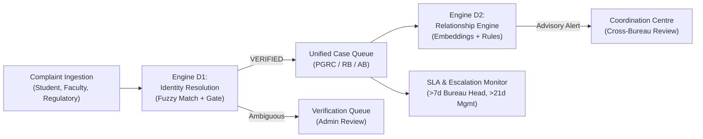

# AICTE Integrated Institution Complaint Monitoring and Status Dashboard
## Project Overview & Mission Charter

> **Initiative:** Smart India Hackathon (SIH) 2026  
> **Problem Title:** AICTE Integrated Institution Complaint Monitoring and Status Dashboard  
> **Status:** Foundation Initialized &bull; Prototype Scaffolding Completed  
> **Collaborator Handoff:** Prepared for Claude Pro  

---

## 1. Problem Statement & Core Challenge

The All India Council for Technical Education (AICTE) oversees thousands of technical, management, pharmacy, architecture, and polytechnic institutions across India. Currently, grievances and regulatory non-compliance reports arrive through fragmented channels:
- **Public Grievance Redressal Cell (PGRC):** Receives student, parent, and faculty complaints (e.g., refusal to refund fees after withdrawal, withheld original certificates, unpaid faculty salaries).
- **Regulation Bureau (RB):** Initiates regulatory compliance checks, investigates violations of approval norms, unapproved courses, excess admissions beyond sanctioned intake, and ghost faculty.
- **Approval Bureau (AB):** Evaluates annual Extension of Approval (EoA) applications, institutional deficiencies, and approval conditions.
- **Regional Offices:** Handle regional ground inspections and direct institutional communications.

### The Core Operational Friction
When an institution commits an irregularity (for example, withholding fee refunds for multiple students or underpaying faculty), related matters frequently arise simultaneously across multiple Bureaus:
1. **Siloed Awareness:** PGRC handles an individual student refund grievance while RB independently investigates whether the same college violated fee-refund regulations.
2. **Conflicting Regulatory Actions:** One Bureau may initiate a show-cause notice while another Bureau has already negotiated a settlement, or vice versa.
3. **Identity Ambiguity:** Complainants frequently submit informal names (e.g. *"ABC Engg Coll"*), causing systems to fail to aggregate complaints against the correct registered institution.
4. **SLA Deadlines Lacking Hierarchy:** Without automated tracking, cases exceed statutory resolution deadlines without triggering escalation to Bureau Heads or Regional Officials.

---

## 2. Solution Objectives

This project builds an **Integrated Institution Complaint Monitoring & Status Dashboard** that acts as a single-window operational cockpit for AICTE officials:

### Key Functional Pillars
1. **Single-Window Administrative Cockpit:** Unified dashboard providing full institutional visibility across all Bureaus, with role-scoped access control for Bureau Officers, Bureau Heads, Regional Officials, and Senior Management.
2. **Engine D1: Institution Identity Resolution:** Disambiguates incoming college names using exact AICTE permanent IDs, token normalization, and fuzzy string similarity before linking complaints to institutional profiles.
3. **Engine D2: Case Relationship & Overlap Detection:** Advisory intelligence engine that detects cross-Bureau complaints regarding the *same matter* (combining dense semantic embeddings, category-pair rules, and shared reference numbers).
4. **Coordination Centre:** Enables officials from different Bureaus to view flagged overlapping cases, review similarity rationales, and coordinate joint hearings or actions without automated merges.
5. **Hierarchical SLA Tracking:** Configurable turnaround timers with automated two-tier escalations (>7 days overdue to Bureau Head, >21 days overdue to Regional Officials and Senior Management).
6. **Immutable Provenance Architecture:** Strict separation between verified institutional records, unverified historical imports, synthetic demonstration data, and derived algorithm scores.

---

## 3. Technology Stack Summary

- **Frontend:** React 18, Vite, JavaScript (ES modules), React Router v6, CSS Design Tokens (AICTE Government Theme).
- **Backend:** Node.js (v22), Express.js (v4), REST APIs (`/api/v1`), CORS, Centralized Error Envelope.
- **Database:** MongoDB (v7+) with Mongoose ODM, compound indexing, and Change Streams.
- **AI / Embeddings:** Transformers.js (`all-MiniLM-L6-v2`, 384-dimensional dense vectors) executed in-process without external vector database dependencies.
- **Job Scheduling:** Agenda.js (MongoDB-backed persistent task runner) for hourly SLA monitors and nightly KPI aggregations.

---

## 4. Current Repository State

- [x] **Dataset Assessment Completed:** Audited raw Harvard Dataverse ACSS data and verified the 9 synthetic operational datasets (`docs/DATASET_ASSESSMENT.md`).
- [x] **Git Repository Initialized:** Configured with strict `.gitignore` preventing exposure of raw PII archives and environment secrets.
- [x] **Frontend Shell Operational:** Built responsive React administrative UI with Sidebar, Top Header, and placeholder views for Dashboard, All Cases, Institutions, Overlap Detection, Alerts, and Reports.
- [x] **Backend Foundation Live:** Express server running with MongoDB connection, environment config, centralized error handling, and health check (`GET /api/v1/health` returning 200 OK).
- [x] **Comprehensive Documentation Suite:** 7 architecture and technical specifications created in `docs/`.

---

## 5. Scope & Guardrails

- **Advisory AI Only:** Artificial intelligence components provide advisory coordination recommendations. The system never automatically merges, closes, transfers, or halts any legal or regulatory proceeding.
- **Synthetic Watermarking:** All synthetic demonstration data is explicitly watermarked with `SYNTHETIC` and carries `SYN-` identifiers to prevent confusion with genuine historical AICTE facts.
- **No Production Claim:** This software is an evaluation prototype created for Smart India Hackathon 2026 and does not claim direct authorization or live integration with AICTE production servers.
