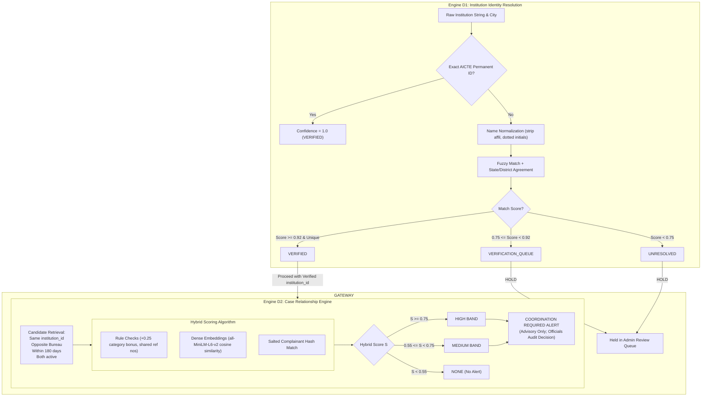
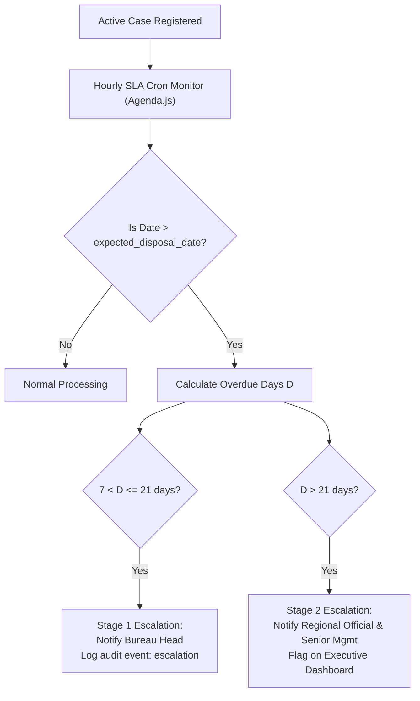

# AICTE Integrated Institution Complaint Monitoring and Status Dashboard
## System Architecture Specification

> **Architectural Reference:** `docs/architecture.png`  
> **Status:** Architecture Blueprint Finalized &bull; Foundation Layer Implemented  
> **Target Framework:** React SPA · Node.js / Express Modular Monolith · MongoDB Replica Set · In-Process Transformers.js  

---

## 1. Architectural Blueprint & Layered Overview

The system architecture follows a **modular monolith** design pattern, prioritizing maintainability, auditability, and operational simplicity without introducing unnecessary microservice or distributed-streaming complexity.

```
+-----------------------------------------------------------------------------------------+
|                                    A. USER & ACCESS                                     |
|  [PGRC Officers]  [RB Officers]  [Other Bureau]  [Regional Officials]  [Senior Mgmt]    |
+-----------------------------------------------------------------------------------------+
                                             | HTTPS (TLS) · JWT Bearer
+-----------------------------------------------------------------------------------------+
|                                    B. PRESENTATION                                      |
|    React SPA (Vite) · Central Dashboard · Cases Explorer · Institution 360° Profiles   |
|    Overlap Detection · Coordination Centre · Alerts & Escalations · Reports & Analytics |
+-----------------------------------------------------------------------------------------+
                                             | REST /api/v1 · Socket.IO Real-Time Gateway
+-----------------------------------------------------------------------------------------+
|                                  C. API & APPLICATION                                   |
|   Rate Limiter · JWT Auth · RBAC & Scope · Zod Validation · Express Controllers/Services |
|   Modules: Ingestion · Institutions · Cases & Status · Assign/Transfer · Reports · Audit|
+-----------------------------------------------------------------------------------------+
               |                                            |
               v                                            v
+-----------------------------+              +--------------------------------------------+
|    D1. IDENTITY RESOLUTION   |              |         D2. CASE RELATIONSHIP ENGINE       |
|  - Exact Permanent ID match |  GATEWAY     |  - Candidate Retrieval (InstId, 180d, act) |
|  - Token normalization      | -----------> |  - Rule-Based Category Points (+0.25)      |
|  - Fuzzy Jaro-Winkler/Token | VERIFIED ONLY|  - Dense Embeddings (all-MiniLM-L6-v2)     |
|  - Gate: >=0.92 VERIFIED    |              |  - Hybrid Classifier -> Advisory Alert     |
+-----------------------------+              +--------------------------------------------+
                                             |
+-----------------------------------------------------------------------------------------+
|                            E. WORKFLOW & TASK SCHEDULING                                |
|   Agenda.js (MongoDB-backed) · Hourly SLA Deadline Monitor · Two-Tier Escalations        |
|   Nightly KPI Aggregations · Notification Dispatcher · Transfer Acceptance Workflow     |
+-----------------------------------------------------------------------------------------+
                                             |
+-----------------------------------------------------------------------------------------+
|                                      F. DATA LAYER                                      |
|   MongoDB Replica Set · Collections: institutions, inst_aliases, cases, case_actions,   |
|   case_links, overlap_candidates, transfers, bureaus, users, notifications, audit_logs  |
+-----------------------------------------------------------------------------------------+
```

---

## 2. Core Subsystems & Components

### 2.1 Layer A: User & Access (RBAC & Data Scopes)
Access is strictly role-scoped based on administrative jurisdiction:
- **PGRC Officers:** Own cases and cross-Bureau overlap read-only view.
- **RB Officers:** Own cases, regulatory investigation queues, and compliance show-cause records.
- **Other Bureau Officers (AB):** Bureau-scoped cases and deficiency assessments.
- **Regional Officials:** Region-scoped view (9 AICTE regions); can view and escalate regional institution issues.
- **Senior Management (Council / Member Secretary):** Unrestricted cross-Bureau visibility, national KPI dashboards, and critical escalation inboxes.
- **System Administrators:** User management, master data imports, and verification queue resolution.

### 2.2 Layer B: Presentation Layer (React SPA)
- Built with Vite, modern JavaScript (ES modules), and React Router v6.
- Styled using a dedicated CSS token system matching AICTE government standards (`#1F3A5F` deep navy, `#D97706` amber accents).
- Single-window layout with responsive collapsible sidebar, fixed administrative header, and interactive operational pages.
- Client state managed via standard React patterns, prepared for TanStack Query and Socket.IO client event handling.

### 2.3 Layer C: API & Modular Application Core
- Express.js modular monolith serving `/api/v1` REST endpoints.
- **Security Middlewares:** CORS preflight configuration, JSON payload limits (10MB), and centralized error handling envelope.
- Planned middleware pipeline: Helmet security headers, Express rate-limiting, JWT authentication, and Zod request body validation.

---

## 3. Intelligence Engines: Identity Resolution vs. Case Relationship

> [!IMPORTANT]
> **Strict Architectural Separation:** Institution Identity Resolution (Engine D1) and Case Relationship Detection (Engine D2) are separate subsystems with separate algorithms, independent scores, distinct databases, and separate audit fields.



### 3.1 Sub-Engine D1: Institution Identity Resolution ("Which institution is this?")
- **Exact Match:** If an AICTE Permanent ID (e.g. `1-100037` or `SYN-1-100037`) is provided, identity confidence is **1.0 (VERIFIED)**.
- **Normalization:** Cleans strings, resolves standard contractions (*Engg.* &rarr; *Engineering*, *Inst.* &rarr; *Institute*, *Coll.* &rarr; *College*), strips generic prefixes (*The*, *Our*, *Government*).
- **Fuzzy Token Matching:** Evaluates token-set similarity constrained by geographical agreement (State and District match).
- **Gating Policy:**
  - $\ge 0.92$ & Unique: Marked `VERIFIED`.
  - $0.75 \le \text{Score} < 0.92$ (or ambiguous matches such as identical names in different cities): Marked `VERIFICATION_QUEUE`.
  - $< 0.75$: Marked `UNRESOLVED`.
  - **Hard Gate:** Only cases with `VERIFIED` institution identities enter Engine D2 candidate retrieval.

### 3.2 Sub-Engine D2: Case Relationship & Overlap Detection ("Are these cases about the same matter?")
- **Candidate Retrieval Filter:**
  - Identical `institution_id` (verified).
  - Cross-Bureau participation (`bureau_a != bureau_b`).
  - Active status (`status != 'Disposed'`).
  - Time window: Receipt dates within **180 days** of each other.
- **Scoring Equation:**
  $$\text{Score} = 0.45 \times \text{RuleScore} + 0.40 \times \text{SemanticCosine} + 0.15 \times \text{MetaBonus}$$
  - $\text{RuleScore}$: Category-pair matrix points (+0.25 bonus if categories match `category_matrix.csv`).
  - $\text{SemanticCosine}$: Cosine similarity of 384-dimensional dense vectors generated by `all-MiniLM-L6-v2` over `(subject + " " + description)`.
  - $\text{MetaBonus}$: Triggered if formal reference numbers (`refs`) or complainant hashes match.
- **Classification Bands:**
  - **HIGH Band ($\ge 0.75$):** Strong evidence of identical underlying matter or shared reference letter. Triggers *Coordination Required* alert.
  - **MEDIUM Band ($0.55 - 0.74$):** Overlapping issues in related categories with conceptual similarity. Triggers *Coordination Required* alert.
  - **NONE ($< 0.55$):** Different institutional matters (e.g., fee refund vs campus building maintenance). No alert raised.
- **Advisory Guardrail:** Overlap detection generates an advisory card in the Coordination Centre. It **never** automatically merges cases, halts regulatory notices, or transfers files without human authorization.

---

## 4. Layer E: Workflow, SLA & Automated Escalation Engine



- **SLA Parameters:**
  - Default turnaround: `PGRC` = 30 days, `RB` = 60 days, `AB` = 45 days.
  - Case deadline: $\text{expected\_disposal\_date} = \text{receipt\_date} + \text{SLA}$.
- **Two-Tier Automated Escalation Hierarchy:**
  - **Stage 1 (> 7 days past due):** Case is flagged overdue and escalated to the Bureau Head.
  - **Stage 2 (> 21 days past due):** Case is escalated to the Regional Official and Senior Management executive queues.

---

## 5. Layer G: Ingestion Pipeline with Provenance Verification

```
Payload (XLSX / CSV / JSON)
         │
         ▼
[1. Parse & Stage] ──> Calculate SHA-256 batch hash; stage raw input
         │
         ▼
[2. Schema Validate] ──> Zod validation of required columns and date types
         │
         ▼
[3. Normalize & Dedupe] ──> Strip whitespace; generate row_hash; catch duplicate clicks
         │
         ▼
[4. Relevance Triage] ──> Filter out portal IT support tickets (82.3% noise)
         │
         ▼
[5. Identity Resolution] ──> Call Engine D1; route ambiguous to Verification Queue
         │
         ▼
[6. Provenance & Upsert] ──> Apply immutable tag (SYNTHETIC / IMPORTED_UNVERIFIED);
                             Insert to MongoDB; trigger embedding generation job
```

---

## 6. Implementation Status Matrix

| Component | Status | Details & Progress |
|---|---|---|
| **Git Repository & .gitignore** | **`IMPLEMENTED`** | Initialized, quarantined raw data, configured exclusions. |
| **Backend Express Server** | **`IMPLEMENTED`** | Binds port 5000, environment config, CORS, error handling. |
| **Health Check Endpoint** | **`IMPLEMENTED`** | `GET /api/v1/health` reporting live uptime, memory, and DB state. |
| **MongoDB Connection Module** | **`IMPLEMENTED`** | Resilient connection with auto-reconnect, error trapping, and state reporting. |
| **Frontend Vite/React Shell** | **`IMPLEMENTED`** | AppLayout, Sidebar, Top Header, AICTE color theme, responsive shell. |
| **Frontend Placeholder Views**| **`IMPLEMENTED`** | Dashboard, All Cases, Institutions, Overlap, Alerts, Reports. |
| **Data Provenance Watermarking**| **`IMPLEMENTED`** | Visual ProvenanceTag badges (`SYNTHETIC`, `IMPORTED_UNVERIFIED`, etc.). |
| **Mongoose Models & Schemas** | *`PROPOSED / NEXT`* | Next task for Claude Pro (create Mongoose schemas). |
| **Synthetic Data Ingestion** | *`PROPOSED / NEXT`* | Next task for Claude Pro (import CSV fixtures into MongoDB). |
| **Engine D1 Fuzzy Matcher** | *`PROPOSED / NEXT`* | Identity resolution logic and verification queue API. |
| **Engine D2 Similarity Engine**| *`PROPOSED / NEXT`* | In-process Transformers.js MiniLM embedding & hybrid scoring. |
| **Agenda.js Scheduling** | *`PROPOSED / NEXT`* | Background cron worker for SLA escalations. |
| **JWT Authentication & RBAC** | *`PROPOSED / NEXT`* | Auth controller, JWT sign/verify, role-scoped middleware. |
